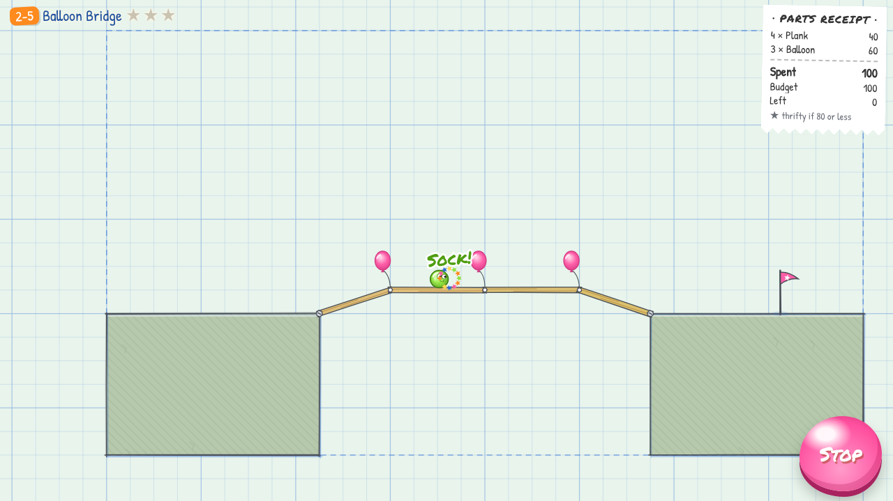

<div align="center">

# Wobbleworks

### Build it wobbly. Press **Go!** Cheer for Wob.

A physics building puzzle for the browser. Lay planks, hang ropes, fit springs, tie on balloons, bolt down wheels and slap on sticky pads, then press **Go!** and watch Wob the jelly blob roll, squish and boing its way to the flag.

**▶ Play: <https://gorzawebk.github.io/wobbleworks/>**


<sub>Screenshot placeholder. Swap `docs/screenshot.png` for any 1280×720 capture you like.</sub>

</div>

---

## What it is

- **32 puzzles in 4 worlds**, each adding a new part or idea, starting gently:
  - **Workshop**: planks, then rope. Gaps, pits and walls.
  - **Windy Cliffs**: springs, wind and updrafts, then balloons.
  - **Soggy Swamp**: water Wob must not touch, wheels as rollers, bobbing logs.
  - **Space Junkyard**: sticky pads (make your own bolts), low gravity, drifting junk.
- **Three stars per puzzle**: one for reaching the flag, one for being thrifty (spending no more than the target), one for finding the hidden sock.
- **Stress you can see**: parts go from green to red as they strain, creak, then snap. A colour-blind setting switches to blue→orange and adds stripes and "!" marks.
- **Wob never gets hurt.** If it falls or gets soggy it just boings back to the start.
- **Undo/redo, grid snapping on or off, zoom and pan, and a slow-motion replay** of every run.
- **2-player race** on one keyboard: split screen, same puzzle, 60 seconds to build, then both Wobs go at once. First to the flag (or furthest) wins.
- **Level editor**: paint ground and ramps, add bolts, water, wind and moving blocks, set the budget and parts, test it, and share it as a short level code.
- **Inventor accounts**: pick a username (*don't use your real name*), and stars, unlocked worlds, saved levels and settings are kept in the browser. Several pupils can share one computer. An **account code** (or downloaded file) moves progress to another device.

## Controls

| Action | Mouse / touch | Keyboard |
| --- | --- | --- |
| Place a part | Drag from one point to another (tap for balloons, wheels, sticky pads) | Move the cursor with **WASD** or arrows, **Q / E** to turn it, **F** to change length, **Space** (or Enter) to place |
| Choose a part | Tap it in the wooden tray | **1–7**, or **R** for the next one |
| Rub out a part | Rubber tool, or right-click the part | Rubber tool + **Space** |
| Undo / redo | ↶ ↷ buttons | **Ctrl+Z** / **Ctrl+Y** (or **X**) |
| Go! / Stop | The big orange button | **G** |
| Zoom and pan | Pinch and two-finger drag, mouse wheel, or the ± buttons | |
| Pause | ❚❚ button | **Esc** or **P** (the game also pauses when you switch tab) |

**2-player race**

| | Player 1 | Player 2 |
| --- | --- | --- |
| Move cursor | W A S D | Arrow keys |
| Turn part | Q / E | , / . |
| Place | Space | Enter |
| Next part | R | / |
| Change length | F | ' |
| Undo | X | Backspace |

Every key can be changed in **Settings**. On a touch screen each player builds by dragging on their own half.

## Run it locally

There's no build step: it's plain HTML, CSS and JavaScript modules. Browsers won't load modules from a `file://` page, so serve the folder:

```bash
git clone https://github.com/GorzaWebK/wobbleworks.git
cd wobbleworks
python3 -m http.server 8642      # or: npx serve .
```

Then open <http://localhost:8642/>. Add `?level=w2-5` to jump straight to a puzzle (once you've made an inventor).

### Checks

```bash
npm test          # every level beatable within budget, every star reachable, deterministic;
                  # level and account codes round-trip
npm run e2e       # browser checks with Playwright (needs the local server running)
```

`tools/try-build.mjs` runs any build on a level and prints Wob's path, which is handy for designing levels. `tools/solutions.json` holds a tested solution for every level.

## How it's made

```
index.html            all the screens
src/physics/          Verlet physics: points, links, welded joints, rolling Wob and wheels,
                      tile ground, water, wind, moving blocks, stress and snapping
src/game/             parts, building (undo/redo), runs, single player, 2-player race, input
src/levels/           level loading, unlocks, level codes; data/world1-4.json
src/editor/           the level editor
src/render/           pencil-sketch drawing, Wob's jelly look, effects, thumbnails
src/ui/               menus, HUD, transitions, styles
src/audio/            Web Audio sound effects and music, all generated
src/account/          inventor profiles and account codes
tools/                level checks, design tools, browser tests, artwork generator
assets/               self-hosted fonts, favicon, icons, social card
```

- **Deterministic physics.** The simulation always steps at 120 Hz with a fixed number of solver passes, uses no randomness, and only uses `+ − × ÷` and `sqrt` inside a step, so the same build plays out exactly the same way every time, on every computer. The slow-motion replay simply runs it again.
- **Light on weak hardware.** The pencil-drawn ground is cached, the canvas drops to a lower resolution if frames get slow, and a slow computer runs the physics in slow motion rather than stuttering.
- **School-friendly.** No chat, no adverts, no tracking, no outside links and no network requests at all: the fonts (Patrick Hand and Permanent Marker, both open licences) are self-hosted, and every picture and sound is made in code. Saves live only in the browser.
- **Accessible.** Keyboard play throughout, rebindable keys, colour-blind stress patterns, and `prefers-reduced-motion` support (or choose it in Settings).

The artwork in `assets/` (favicon, icons and the social card) is drawn by `tools/art.html` with the game's own drawing code; `npm run art` regenerates it.

## Credits

Game design, code, levels, art and sound: made for [Brain Break Lab](https://brainbreaklab.co.uk).
Fonts: [Patrick Hand](https://fonts.google.com/specimen/Patrick+Hand) (SIL Open Font License) and [Permanent Marker](https://fonts.google.com/specimen/Permanent+Marker) (Apache License 2.0); licences in `assets/fonts/`.
